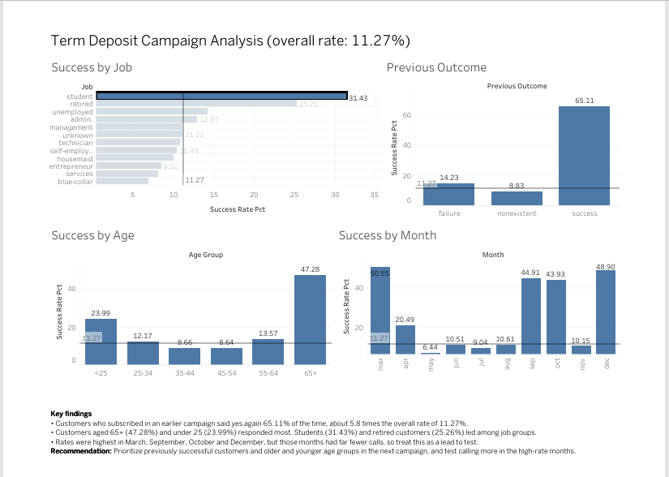

# Bank Marketing Campaign Analysis

Which customers are most likely to subscribe to a term deposit, and how could a bank target its calls better?

**[View the interactive dashboard on Tableau Public](https://public.tableau.com/app/profile/devika.janu/viz/BankMarketingCampaignAnalysis_17945447935380/Dashboard1)**



## Business problem

A Portuguese bank phoned customers to sell a term deposit. Only 11.27% of contacts subscribed. This project analyses who said yes, so that future campaigns can focus on the most promising customers.

## Dataset

[UCI Bank Marketing dataset](https://archive.ics.uci.edu/dataset/222/bank+marketing) (`bank-additional-full.csv`): about 41,000 customer contacts (41,176 after removing duplicate rows) from 2008 to 2010, with 21 columns covering customer profile, contact details, previous campaign results and the outcome.

## Tools

Python (Pandas), SQL (SQLite), Jupyter Notebook, Matplotlib, Tableau Public, Git/GitHub, VS Code.

## Approach

1. **Cleaned the data** with a Python script: renamed columns, removed duplicate rows, converted the outcome to 1/0, created age groups and a "contacted before" flag. "Unknown" values were kept as their own category.
2. **Loaded it into a SQLite database** and wrote 7 SQL queries (one per business question) using `GROUP BY`, `ORDER BY` and aggregate functions (`COUNT`, `SUM`, `ROUND`).
3. **Visualised the results** in a notebook and in a Tableau dashboard.
4. **Excluded the `duration` column** (call length) on purpose. It is only known after a call ends, so it cannot be used to decide whom to call.

## Key findings

- **The overall subscription rate was 11.27%.**
- **Previous success stands out most..** Customers who subscribed in an earlier campaign said yes again 65.11% of the time, about 5.8 times the overall rate. Customers never contacted before subscribed at 8.83%.
- **Age shows a U-shaped pattern.** Customers aged 65+ subscribed at 47.28% and those under 25 at 23.99%, while ages 35 to 54 were lowest at about 8.6%.
- **Month:** Success rates were highest in March (50.55%), December (48.9%), September (44.91%) and October (43.93%), but these months had far fewer calls (182 to 717 contacts each) than May to August, which accounted for about 79% of all contacts at rates of 6% to 11%. May had the most calls (13,767) and the lowest rate (6.44%).

## Recommendations

- Prioritise customers who subscribed in a previous campaign.
- Give more attention to customers aged 65+ and under 25.
- Test shifting more calls to the high-rate months and measure whether the results hold at larger volume.

## Limitations

- The data is from 2008 to 2010 and from one Portuguese bank, so the patterns may not apply to other banks or today's customers.
- Some groups (for example students, retirees, and the under-25 and 65+ age groups) are small, so their rates are less certain.
- The analysis shows which groups subscribe more, not why. It is descriptive and does not prove cause.

## How to run

```bash
pip install -r requirements.txt
python src/build_database.py
python src/run_queries.py
```

Download `bank-additional-full.csv` from the UCI page and place it in `data/raw/` first.

## Project structure

```
├── data/raw/          original CSV (not uploaded)
├── notebooks/         exploration and charts
├── sql/               one SQL query per business question
├── src/               data cleaning and query-runner scripts
├── outputs/           query results and figures
└── requirements.txt
```